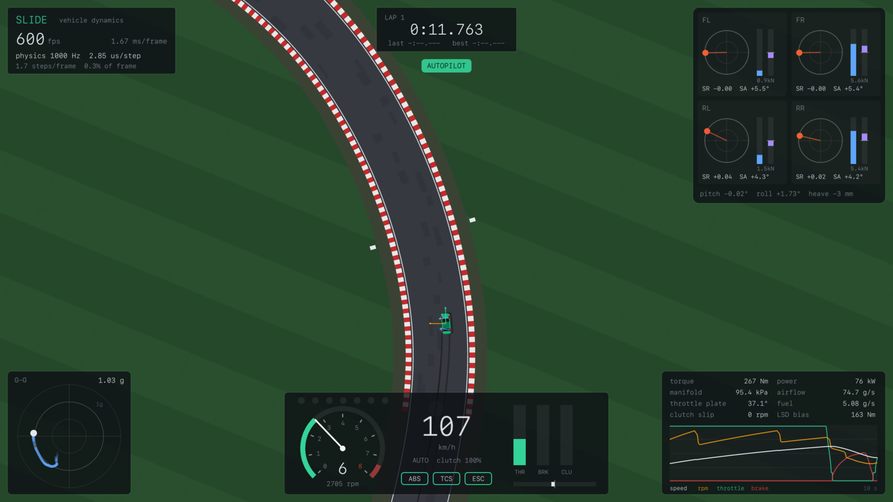

# Slide

A real-time vehicle dynamics engine in C++20. Engine torque comes from an air-path
and combustion model, suspension load transfer is dynamic, and the tires use the
Pacejka Magic Formula with transient slip. The physics runs at a fixed 1 kHz with
deterministic output, while the renderer runs uncapped (600+ FPS at 3200×1800 on
an M2 Max) and interpolates between physics steps.



The physics core is a dependency-free static library. On top of it sit three
programs:

| Target | What it is |
|---|---|
| `slide` | raylib visualizer: drive it yourself or watch the autopilot, with live tire, suspension and engine telemetry |
| `slide-bench` | headless test stand: engine dyno sweep, launch, braking, skidpad, step steer, lap simulation, throughput benchmark |
| `slide-tests` | 34 physics regression tests: equilibrium, determinism, energy, load transfer, ABS/TCS, timestep convergence, a 10-minute randomized-input fuzz run |

## What is modeled

- **Tires.** Magic Formula pure slip with load-sensitive friction.
  Similarity-method combined slip, so grip follows a friction ellipse rather
  than a clipped circle. Relaxation-length transient slip keeps a standstill
  well defined. Staggered front and rear compounds.
- **Suspension.** Sprung body with heave, pitch and roll on four
  spring/damper struts. Asymmetric bump/rebound damping, progressive bump stops,
  anti-roll bars and roll-center geometric load transfer. Tire loads come from
  strut forces, so weight transfer happens at the pace the dampers allow.
- **Engine.** Mean-value spark-ignition model. A compressible orifice flow
  through the throttle (choked and unchoked) fills a manifold plenum, solved
  implicitly. Torque comes from volumetric efficiency, trapped air and fuel
  energy, minus friction and pumping work. The ECU adds idle-speed PI control,
  a rev limiter, overrun fuel cut, WOT enrichment, stalling and a starter.
- **Drivetrain.** Friction clutch solved as a velocity constraint (it locks,
  slips and syncs through one rule), 6-speed box with automatic or sequential
  shifting, ignition-cut upshifts, rev-matched downshifts and a clutch-pack LSD.
- **Chassis.** Planar rigid body with aero drag and downforce, Ackermann
  steering and a speed-sensitive rack.
- **Driver aids.** PI slip-control ABS, traction control, and yaw-rate stability
  control against a bicycle-model reference.
- **Track.** Spline circuit that doubles as terrain: asphalt, rumble-strip curbs
  and bumpy low-grip grass, queried through a spatial grid.

[docs/PHYSICS.md](docs/PHYSICS.md) has the equations and the reasoning behind
each numerical choice.

## Test-stand results

From `slide-bench all` (1 kHz physics, default 1350 kg coupe, 3.2 L naturally
aspirated six):

| Test | Result |
|---|---|
| Engine dyno, WOT | 299 Nm @ 4000 rpm, 183 kW (245 hp) @ 6750 rpm, BSFC 258–304 g/kWh |
| 0–100 km/h | 5.54 s |
| Quarter mile | 13.78 s @ 170 km/h |
| 100–0 km/h braking | 36.4 m with ABS, 44.0 m with locked wheels |
| Skidpad, 40 m radius | 0.85 g, understeer gradient 0.98 °/g |
| Step steer @ 80 km/h | yaw rate 90% response in 161 ms, 4.5% overshoot |
| Autopilot lap, 1.48 km circuit | 58.57 s, 1.09 g peak lateral, never off track |
| Physics step | 1.0 µs, about 980× faster than real time |

At 300 FPS each frame runs about 3.3 physics steps, which is roughly 3.4 µs, or
0.1% of the frame budget. Rendering, not physics, sets the frame rate.

## Build

Requires CMake ≥ 3.25 and a C++20 compiler. raylib 5.x is used if installed
(`brew install raylib`); otherwise CMake downloads it. The physics core, bench and
tests need nothing extra.

```sh
cmake --workflow --preset release   # configure, build and test in one step
./build/slide                       # drive
./build/slide --demo                # autopilot
./build/slide-bench all             # test stand
```

After the first run, `cmake --build build` rebuilds only what changed. With
CMake < 3.25, configure by hand with `cmake -S . -B build`, then build with
`cmake --build build -j`.

### Browser version

The visualizer also compiles to WebAssembly with Emscripten
(`brew install emscripten`, or emsdk). CMake finds the toolchain on its own:

```sh
cmake --workflow --preset web               # writes build-web/index.{html,js,wasm,data}
python3 -m http.server -d build-web 8000    # then open http://localhost:8000
```

The page opens on autopilot; press P to drive, or open `#drive` to start in
control. The physics is the same 1 kHz core. Browsers cap rendering at the
display refresh rate, so each frame runs about 17 physics steps at 60 Hz.
Telemetry recording is desktop-only. `.github/workflows/pages.yml` publishes
the build to GitHub Pages on every push to `main`.

Useful flags:

- `slide --hz 2000` changes the physics rate.
- `slide --vsync` syncs to the display; the default is uncapped.
- `slide --frames 3000` runs a timed session and prints FPS and µs per step.
- `slide-bench dyno --csv dyno.csv` writes the dyno table.
- `slide-bench laps --csv lap.csv` writes 100 Hz telemetry with 63 channels.
- `--no-abs`, `--no-tcs` and `--no-esc` turn driver aids off.

## Controls

| Key | Action |
|---|---|
| W / S, arrows | throttle / brake (hold S at a stop for reverse) |
| A / D | steer |
| Space | handbrake (dips the clutch, for drifting) |
| Left Shift | clutch |
| E / Q | shift up / down (switches to manual) · M toggles auto/manual |
| 1 / 2 / 3 | ABS / traction control / stability control |
| P | autopilot |
| T | record telemetry CSV |
| V | x-ray: per-tire force vectors and utilization |
| C | chase / north-up camera · mouse wheel zooms |
| R | reset · I crank engine · Tab hide HUD · F1 help |

A gamepad also works: left stick steers, the triggers are the pedals, A is the
handbrake and the bumpers shift.

## Layout

```
include/slide/   public headers: Vehicle, Tire, Suspension, Engine, Drivetrain,
                 DriverAids, Track, Autopilot, Telemetry, Config (all parameters)
src/physics/     simulation core (no dependencies)
src/app/         raylib visualizer: world renderer, HUD, skid marks and smoke
src/bench/       slide-bench test stand
tests/           slide-tests and a tiny self-registering test harness
docs/            physics write-up
```

Vehicle parameters live in `include/slide/Config.h` as plain structs. Every
value is SI and documented, and the defaults describe a 1350 kg rear-drive coupe.

## Acknowledgments

The project layout (rigid body, wheels, engine, gearbox, TCS/ABS, SDL-era HUD)
started from [KrushedKnight/CarPhysicsEngine](https://github.com/KrushedKnight/CarPhysicsEngine).
Slide is a from-scratch rewrite with a different model for every subsystem.
